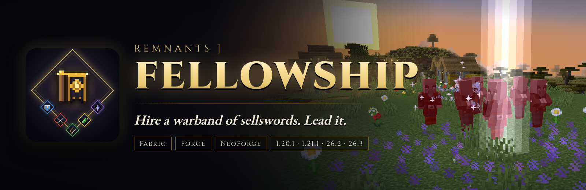

# Remnants | Fellowship



Hire named sellswords with gold and lead them as a warband. Five classes, aggro and taunts, allies that are downed
instead of killed and revived by you or a Mender, formations, a command wheel, a Warbanner to rally on, and a
Chronicle written from what each ally actually lived through.

Formerly *Better With Gold*. The mod id is still `better_with_gold`, so 1.x worlds keep their gold gear, now the
Gilded Regalia, whose recipes are back.

## Supported versions

These are the only supported targets (the NightBeam convention): 8 jars per release, all with the same version.

| Minecraft | Loaders | Java | Folder |
| --- | --- | --- | --- |
| 1.20.1 | Forge, Fabric | 17 bytecode (build on 21) | `1.20.1/{common,forge,fabric}` |
| 1.21.1 | NeoForge, Fabric | 21 | `1.21.1/{common,neoforge,fabric}` |
| 26.2 | NeoForge, Fabric | 25 | `26.2/{common,neoforge,fabric}` |
| 26.3 | NeoForge, Fabric | 25 | `26.3/{common,neoforge,fabric}` |

Each version root is an independent Gradle project with its own wrapper. Fabric builds need Fabric API; nothing else
is required.

## Features

- **Sellswords** for hire near village bells, paid in gold ingots: name, class, level, traits and price above their head.
- **Five classes** (Bulwark, Skirmisher, Ranger, Mender, Arcanist), eleven traits, levels 1 to 20 with titles, and morale.
  Classes are JSON files packs can edit or extend.
- **Command wheel** (hold G): Follow, Charge, Focus, Hold, Fall back, Guard banner, Formation, Recall.
- **Formations** (Line, Wedge, Shield Wall, Circle) and the **Warbanner** rally point.
- **Aggro:** enemies attack whoever holds the most aggro; Bulwarks taunt; a label shows who each enemy is after.
- **Downed, not dead:** crouch beside a downed ally to revive it; Menders revive by themselves. Optional permadeath
  with a Remembrance of the fallen.
- **Roster** (U) with every ally's **Chronicle**, and **party frames** on the HUD.
- **Allies travel with you** through log-outs and portals; Recall finds any left behind.
- Optional link to Remnants | RPG Stats, Skills & Progression (RPG Attribute System).

Player documentation lives in [docs/](docs/README.md). Store-page copy and art are in [marketing/](marketing/README.md).

## Building

```bash
export JAVA_HOME_17=/path/to/jdk-17 JAVA_HOME_21=/path/to/jdk-21 JAVA_HOME_25=/path/to/jdk-25
export JAVA_HOME=$JAVA_HOME_21
./gradlew buildAll             # every workspace, then the 8 loader jars into releases/
cd 1.20.1 && ./gradlew build   # Gradle on Java 21 (Java 17 toolchain)
cd 1.21.1 && ./gradlew build   # Java 21
cd 26.3 && ./gradlew build     # Java 25 (the same for 26.2)
```

The root build hands the 26.x workspaces `JAVA_HOME_25_X64` / `JAVA_HOME_25` (or `-Pjava25Home=<jdk>`) and the
others `JAVA_HOME_21_X64` / `JAVA_HOME_21` (or `-Pjava21Home=<jdk>`); without them each workspace uses the current
`JAVA_HOME`. Jars land in `<workspace>/<loader>/build/libs/better_with_gold-<loader>-<minecraft>-<version>.jar`, and
`buildAll` copies the 8 of them into `releases/`. `check` in a workspace also runs the core regression suite
(`./gradlew :common:coreRegression`: aggro, formations, progression, Chronicle text, saved data and config files).

Every workspace's `gradle.properties` and the root `VERSION` file carry the same version (`./gradlew checkVersions`;
set it with `./gradlew syncVersion -PmodVersion=x.y.z`). `python3 scripts/check_targets.py workspaces` checks the
targets, the shared version and the metadata ranges.

Version-independent code is edited in `1.21.1/` and copied to the other roots with
`tools/sync-shared.sh 1.20.1 26.2 26.3`. Textures, recipes and the reference docs are generated by
`tools/gen_textures.py`, `tools/gen_data.py` and `tools/gen_docs.py`.

## Testing

`tools/qa/` starts a dev server and a client that joins it under Xvfb (`devrun.sh`), and
`tools/qa/fellowship_checks.py` drives a full play-through over RCON and xdotool: recruiting, following, combat and
aggro labels, downed and revived, the roster, the command wheel and the Warbanner. Release jars are checked with
`scripts/verify-jars.py` and `scripts/smoke-client.py`.

## Releasing

CI (`.github/workflows/ci.yml`) builds all 8 jars on every push to `main` that touches the build. Publishing to
CurseForge is `.github/workflows/publish.yml`, run by hand (`version`, `dry_run`) or by a `v*.*.*` tag;
it never runs on a plain push. It refuses a second release of the mod on the same day (Africa/Tunis), takes the jars
from `releases/`, the GitHub Release or a build from source, and fails unless exactly the 8 jars are found. The
changelog comes from `patchnotes/<version>.md`. It needs the secrets `CURSEFORGE_TOKEN` (upload token) and
`CURSEFORGE_API_KEY` (Core API key) and the variable `CURSEFORGE_ID` (it falls back to this project's ID, `1305455`,
when the variable is unset). NightBeam publishes to CurseForge only; the Modrinth page stays up but gets no new
versions.

## Contributing

See [CONTRIBUTING.md](CONTRIBUTING.md).

## Security

See [.github/SECURITY.md](.github/SECURITY.md).

## License

Apache License 2.0. See [LICENSE](LICENSE) and [NOTICE](NOTICE).
