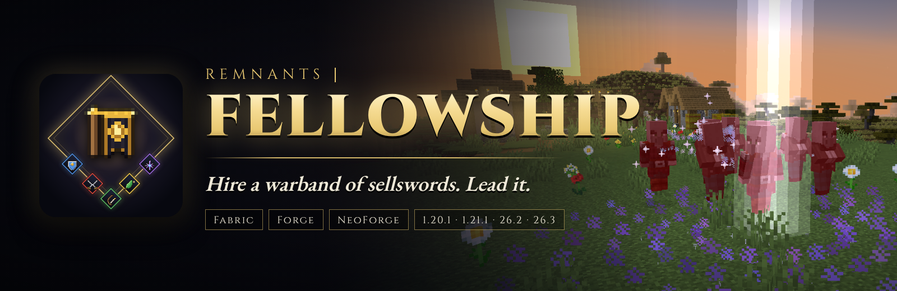

# Remnants | Fellowship



Hire named sellswords with gold and lead them as a warband. Five classes, aggro and taunts, allies that are downed
instead of killed and revived by you or a Mender, formations, a command wheel, a Warbanner to rally on, and a
Chronicle written from what each ally actually lived through.

Formerly *Better With Gold*. The mod id is still `better_with_gold`, so 1.x worlds keep their gold gear, now the
Gilded Regalia, whose recipes are back.

## Supported versions

| Version root | Minecraft | Loaders | Java |
| --- | --- | --- | --- |
| `1.20.1/` | 1.20.1 | Fabric, Forge | 17 |
| `1.21.1/` | 1.21.1 | Fabric, NeoForge, Forge | 21 |
| `26.2/` | 26.2 | Fabric, NeoForge | 25 |
| `26.3/` | 26.3 | Fabric, NeoForge | 25 |

Each version root is an independent Gradle project. Fabric builds need Fabric API; nothing else is required.

## Features

- **Sellswords** for hire near village bells, paid in gold ingots: name, class, level, traits and price above their head.
- **Five classes** (Bulwark, Skirmisher, Ranger, Mender, Arcanist), eleven traits, levels 1 to 20 with titles, and morale.
  Classes are JSON files packs can edit or extend.
- **Command wheel** (hold G): Follow, Charge, Focus, Hold, Fall back, Guard banner, Formation, Recall.
- **Formations** (Line, Wedge, Shield Wall, Circle) and the **Warbanner** rally point.
- **Aggro:** enemies attack whoever holds the most aggro; Bulwarks taunt; a label shows who each enemy is after.
- **Downed, not dead:** crouch beside a downed ally to revive it; Menders revive by themselves. Optional permadeath
  with a Remembrance of the fallen.
- **Roster** (U) with every ally's **Chronicle**, and **party frames** on the HUD.
- **Allies travel with you** through log-outs and portals; Recall finds any left behind.
- Optional link to Remnants | RPG Stats, Skills & Progression (RPG Attribute System).

Player documentation lives in [docs/](docs/README.md). Store-page copy and art are in [marketing/](marketing/README.md).

## Building

```bash
export JAVA_HOME_17=/path/to/jdk-17 JAVA_HOME_21=/path/to/jdk-21 JAVA_HOME_25=/path/to/jdk-25
export JAVA_HOME=$JAVA_HOME_21
./gradlew buildAll
```

Built jars are collected in `all-jars/`. Build one version from inside its folder (`cd 1.21.1 && ./gradlew build`);
`check` there also runs the core regression suite (`./gradlew :common:coreRegression`: aggro, formations,
progression, Chronicle text, saved data and config files).

Version-independent code is edited in `1.21.1/` and copied to the other roots with
`tools/sync-shared.sh 1.20.1 26.2 26.3`. Textures, recipes and the reference docs are generated by
`tools/gen_textures.py`, `tools/gen_data.py` and `tools/gen_docs.py`.

## Testing

`tools/qa/` starts a dev server and a client that joins it under Xvfb (`devrun.sh`), and
`tools/qa/fellowship_checks.py` drives a full play-through over RCON and xdotool: recruiting, following, combat and
aggro labels, downed and revived, the roster, the command wheel and the Warbanner. Release jars are checked with
`scripts/verify-jars.py` and `scripts/smoke-client.py`.

## Release

`git tag v2.0.0 && git push --tags` runs `.github/workflows/publish.yml`, which uploads every loader jar to the
existing Modrinth and CurseForge projects. The changelog comes from `patchnotes/<version>.md`.

## Contributing

See [CONTRIBUTING.md](CONTRIBUTING.md).

## Security

See [.github/SECURITY.md](.github/SECURITY.md).

## License

Apache License 2.0. See [LICENSE](LICENSE) and [NOTICE](NOTICE).
